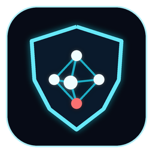
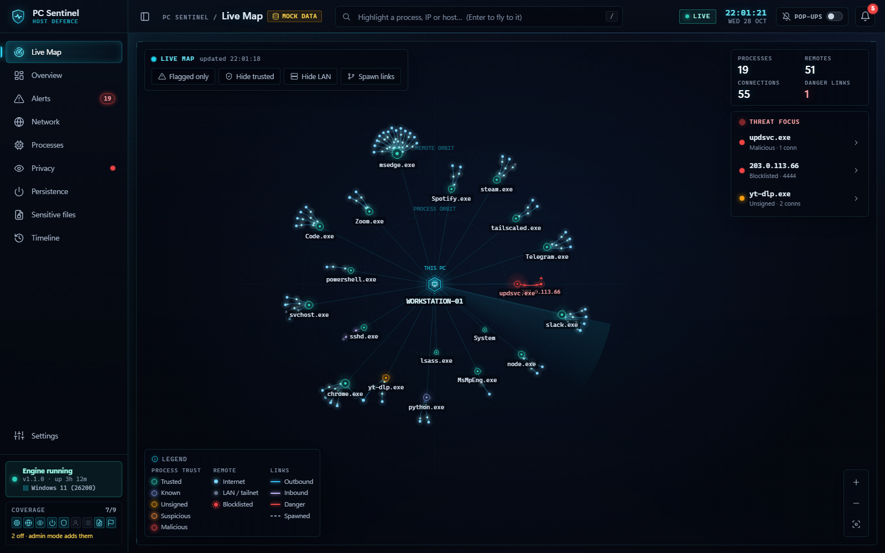

<div align="center">



# PC Sentinel

**See what every app on your computer is doing.**

A free, open-source, local security monitor for **Windows, macOS and Linux**. It watches which programs run, who
they talk to, who uses your camera and microphone, what sets itself to start automatically, and which program reads
your saved passwords. It shows everything on a live map.

[](https://github.com/Safiullah-Rahu/pc-sentinel/actions/workflows/ci.yml)
[](https://github.com/Safiullah-Rahu/pc-sentinel/actions/workflows/codeql.yml)

[](LICENSE)



</div>

## Why
Antivirus asks "is this file known-bad?". Plenty of real malware is brand new, signed with a stolen or forged
certificate, padded to slip past scanners, or hidden in a folder nobody looks at. PC Sentinel asks a different
question: **what is each program actually doing right now, and is that normal?**

## What it shows

- **Live Map**: your computer in the centre, every app as a glowing node, lines to every server it talks to,
  and packets flowing along them. Colour shows trust. Click any node to **kill** it, **block** its destination,
  or **allow** it.
- **Processes**: digital signature checks (Authenticode, Apple `codesign`, Linux package ownership). It flags
  forged or tampered signatures, programs padded to 100+ MB, unsigned programs in odd places, programs in hidden
  folders, and "living off the land" command lines (`powershell -enc`, `curl … | sh`, `/dev/tcp` reverse shells).
- **Network**: every connection per app, new destinations, blocklisted IPs, unusual ports, inbound connections
  from the internet, newly opened ports, and live throughput.
- **Camera and microphone**: which app used them and when (Windows records it; Linux is watched live).
- **Autostart and persistence**: Run keys, Startup folders, scheduled tasks and services; LaunchAgents and
  LaunchDaemons; systemd units, XDG autostart and cron; shell startup files. New or changed entries raise alerts.
- **Sensitive files** (Windows admin mode): which program reads your browsers' saved passwords and cookies,
  crypto wallets or SSH keys, plus bait "canary" files.
- **Defender and system events** (Windows): detections, protection switched off, and exclusions added (a classic
  malware trick).
- **Risk score, alerts with one-click responses, and a timeline.**

Pop-up notifications are **off by default**: you see everything when you open the app. Turn them on in Settings.

## Platform support

| Monitor | Windows | macOS | Linux |
|---|:-:|:-:|:-:|
| Processes, signatures and suspicious traits | ✅ | ✅ | ✅ (package ownership) |
| Network map, destinations and open ports | ✅ | ✅ (your apps; all apps as root) | ✅ |
| Camera / microphone | ✅ | — n/a | ✅ live |
| Autostart / persistence | ✅ | ✅ | ✅ |
| Defender, logons, new accounts, DNS per app, file-read auditing | ✅ (admin mode) | — | — |
| Kill / block IP / start at login | ✅ | ✅ | ✅ |

The automated test suite runs on all three systems in CI on every push.

## Install

**Download** the latest build from [Releases](https://github.com/Safiullah-Rahu/pc-sentinel/releases) and check it
against the `.sha256` file:

- **Windows:** unzip `PC-Sentinel-windows-x64.zip` and run `PC Sentinel.exe`. The build is not code-signed yet, so
  SmartScreen may ask you to confirm with *More info → Run anyway*.
- **macOS:** unzip `PC-Sentinel-macos-arm64.zip` and move **PC Sentinel.app** to Applications. The first time,
  right-click it and choose **Open**, because the app is not notarized yet.
- **Linux:** run `tar xzf PC-Sentinel-linux-x64.tar.gz` then `"PC Sentinel/PC Sentinel"`.

**Or run from source** (Python 3.10+):

```bash
git clone https://github.com/Safiullah-Rahu/pc-sentinel && cd pc-sentinel
python -m venv .venv && . .venv/bin/activate        # Windows: .venv\Scripts\activate
pip install -r requirements-desktop.txt
python desktop.py
```

On Linux the native window needs a web-view backend: either `sudo apt install python3-gi gir1.2-webkit2-4.1` or
`pip install "pywebview[qt]"`. Without one, PC Sentinel opens the dashboard in your browser instead. For a
headless engine, run `python main.py` and open `http://127.0.0.1:8777`.

**Using it:** closing the window keeps monitoring in the background (tray icon on Windows/Linux; on macOS, open the
app again to bring the window back). Turn on **Settings → Start at login** to start it hidden at every login.

### Windows admin mode (optional)
Running PC Sentinel **as administrator** unlocks extra monitors:
- **Security log:** remote logons, new accounts and admin-group changes. Windows records these by default.
- **Sensitive-file auditing:** PC Sentinel adds read-audit rules to your browser password and cookie stores, wallets and SSH keys.

Two of these depend on Windows settings that are off by default. Turn them on yourself if you want them:
- **Who read a sensitive file, and every process start with its command line:** under
  *Local Security Policy → Advanced Audit Policy*, enable **Object Access → Audit File System** (Success) and
  **Detailed Tracking → Audit Process Creation** (Success).
- **Which app looked up which domain:** in *Event Viewer*, enable the **Microsoft-Windows-DNS-Client/Operational** log.

PC Sentinel shows which monitors are active in the sidebar's **Coverage** panel.

## Privacy

Everything stays on your computer: there is no account, no cloud and no telemetry. The only outbound lookups are
reverse-DNS queries for the addresses your apps contact, so a hostname can be shown. Data lives in
`%LOCALAPPDATA%\PCSentinel` (Windows), `~/Library/Application Support/PCSentinel` (macOS) or
`~/.local/share/pcsentinel` (Linux).

**Your own threat intel:** to have IPs and file hashes treated as known-bad, put them in `iocs.json` in that data
folder. The file stays local and never leaves your machine:

```json
{ "blocklist": [["203.0.113.66", "C2 seen in an incident"]],
  "known_bad_sha256": { "E3B0C442…": "dropper from phishing mail" } }
```

## Security

The engine can kill processes and block traffic, so its API is locked down:
- It listens on `127.0.0.1` only.
- Every call needs a per-install token.
- Requests must carry a `127.0.0.1` or `localhost` Host header.
- A strict Content Security Policy is set, and all data shown in the UI is escaped.
- Every value that reaches a privileged command is validated.

CI runs CodeQL, Bandit, Ruff security rules and `pip-audit` on every push. See [SECURITY.md](SECURITY.md) for the
threat model and how to report a vulnerability privately.

**Limits:** PC Sentinel is a monitor, not a replacement for your antivirus. Malware already running as
administrator/root can disable any user-space tool.

## Development

```bash
pip install -r requirements-dev.txt
python -m pytest            # unit, API-security and engine smoke tests
ruff check . && bandit -r sentinel -ll -s B404,B603,B607 && pip-audit -r requirements.txt
pyinstaller --noconfirm pc_sentinel.spec   # build the app for the current OS
```

Layout:
- `main.py` is the engine.
- `desktop.py` is the native window and tray.
- `sentinel/` holds the collectors, rules and API.
- `dashboard/` is the UI (vanilla JS, no build step).
- `docs/API.md` is the API contract.
- `tests/` holds the test suite.

## License

[MIT](LICENSE) © 2026 Safiullah Rahu
